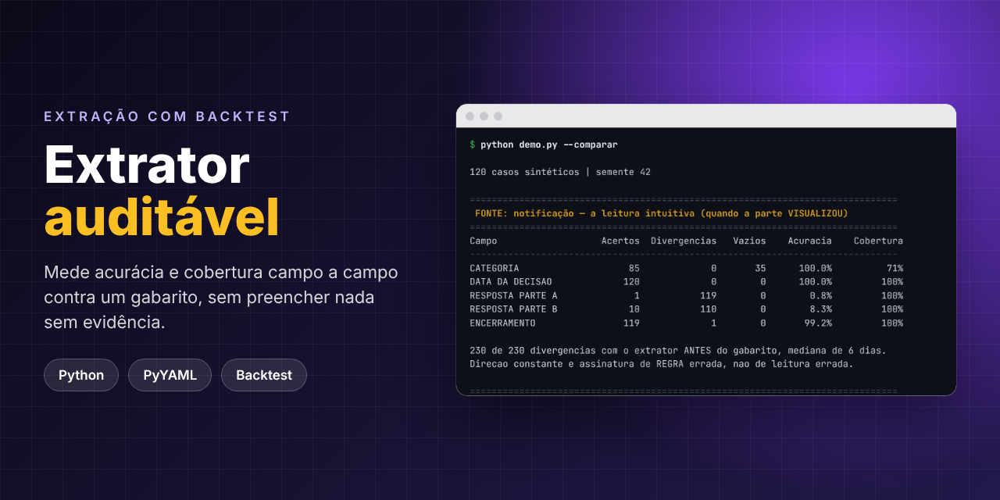
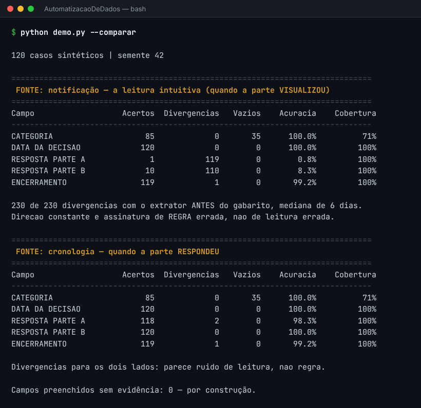
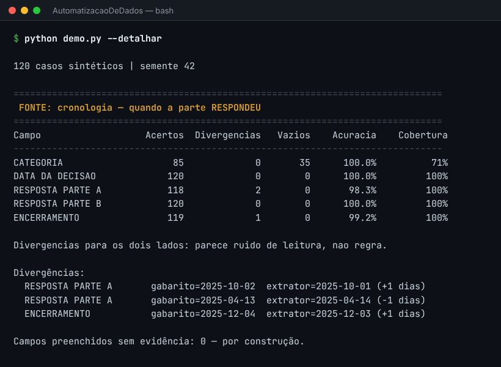

<p align="center">
  
</p>

<h1 align="center">🔎 Extrator auditável</h1>

<p align="center">
  Extração de dados de sistemas web legados com <b>validação por backtest</b>, e a disciplina de
  <b>não preencher nada sem evidência</b>.
</p>

<p align="center">
  
  
  
</p>

<p align="center">
  <a href="#-sobre-o-projeto">Sobre</a> •
  <a href="#-o-método">Método</a> •
  <a href="#-o-que-a-demonstração-mostra">Demonstração</a> •
  <a href="#️-telas">Telas</a> •
  <a href="#️-arquitetura">Arquitetura</a> •
  <a href="#-como-executar">Como executar</a> •
  <a href="#-estrutura-do-projeto">Estrutura</a>
</p>

---

## 📌 Sobre o projeto

Automatizar uma leitura é a parte fácil. Saber se a leitura está certa é o trabalho. Este
repositório é a implementação de referência de um método que nasceu de um projeto real, com
os dados e o sistema de origem substituídos por equivalentes sintéticos.

### O problema

Uma base preenchida à mão, registro por registro, a partir de um sistema web que não tem API.
Cinco campos por registro, espalhados por duas telas. Milhares de registros.

Escrever o robô é simples. A pergunta difícil é: **como saber se ele está lendo certo?**

A resposta usual — "conferi alguns e pareceu bom" — não resolve. O erro que importa não é o
escandaloso; é o de poucos dias, consistente, que passa por qualquer conferência por
amostragem e contamina tudo que depende dele.

## 🧭 O método

Rodar o extrator contra registros **já preenchidos por humanos** e comparar campo a campo.

Duas métricas, e a distinção entre elas é o ponto:

```
acurácia  = acertos / (acertos + divergências)     dos campos preenchidos, quantos bateram
cobertura = preenchidos / (preenchidos + vazios)   em quantos ele conseguiu responder
```

**Cobertura baixa com acurácia alta é um sistema honesto** — ele só responde quando sabe. O
contrário, cobertura alta com acurácia baixa, é o pior resultado possível, porque parece
produtivo.

## 🔬 O que a demonstração mostra

```
$ python demo.py --comparar

120 casos sintéticos | semente 42

==============================================================================
 FONTE: notificação — a leitura intuitiva (quando a parte VISUALIZOU)
==============================================================================
Campo                   Acertos  Divergencias   Vazios    Acuracia    Cobertura
------------------------------------------------------------------------------
CATEGORIA                    85             0       35      100.0%          71%
DATA DA DECISAO             120             0        0      100.0%         100%
RESPOSTA PARTE A              1           119        0        0.8%         100%
RESPOSTA PARTE B             10           110        0        8.3%         100%
ENCERRAMENTO                119             1        0       99.2%         100%

230 de 230 divergencias com o extrator ANTES do gabarito, mediana de 6 dias.
Direcao constante e assinatura de REGRA errada, nao de leitura errada.

==============================================================================
 FONTE: cronologia — quando a parte RESPONDEU
==============================================================================
CATEGORIA                    85             0       35      100.0%          71%
DATA DA DECISAO             120             0        0      100.0%         100%
RESPOSTA PARTE A            118             2        0       98.3%         100%
RESPOSTA PARTE B            120             0        0      100.0%         100%
ENCERRAMENTO                119             1        0       99.2%         100%

Divergencias para os dois lados: parece ruido de leitura, nao regra.
```

Três coisas acontecem aí, e todas vieram do projeto original.

### 1. A direção das divergências denuncia o tipo do erro

Erro de leitura erra para os dois lados. **Erro de regra erra sempre para o mesmo.**

Quando as 230 divergências apontam todas na mesma direção, com mediana de poucos dias, o
defeito não está na leitura — está na definição do que se está lendo. Aqui: o extrator lia a
data em que a parte **visualizou** o aviso, quando o correto é a data em que ela
**respondeu**. Eventos diferentes, separados por poucos dias.

Essa distinção é o que transforma uma lista de erros num diagnóstico. Ela está implementada em
[`src/medicao.py`](src/medicao.py), em `direcao_das_divergencias()`.

### 2. Cobertura de 71% é a resposta certa, não uma falha

Em parte dos casos o sistema registra apenas o ato genérico, sem declarar a categoria. Quem
preencheu à mão sabia o motivo porque leu o documento inteiro — informação que **não existe**
na tela que o robô lê.

Nesses casos o campo sai vazio e marcado. Preencher por aproximação geraria um valor errado
que se propaga em silêncio: mais caro que o trabalho manual que se queria eliminar.

### 3. Nem toda divergência é culpa do extrator

Os 4% restantes são erro humano de transcrição na base de referência — que existe em qualquer
base preenchida à mão. Como erram para os dois lados, a medição os separa do erro sistemático.

Sem isso, a tentação é "corrigir" o extrator até ele reproduzir os erros do gabarito.

## 🖼️ Telas

Saídas reais da demonstração, capturadas rodando os comandos abaixo neste repositório.

<table>
  <tr>
    <td align="center"><b><code>python demo.py --comparar</code></b><br></td>
    <td align="center"><b><code>python demo.py --detalhar</code></b><br></td>
  </tr>
</table>

## 🏗️ Arquitetura

```
Fonte  ──►  Caso  ──►  Extrator  ──►  Resultado  ──►  Medição
(qualquer)  (eventos +   (regras       (campos +      (acurácia,
            notificações) em YAML)      evidência)     cobertura,
                                                       direção)
```

O extrator **não conhece navegador nem HTML**. Recebe listas de texto já lidas de algum lugar.
Essa fronteira é o que permite medir a extração offline, centenas de vezes, sem tocar no
sistema de origem — uma rodada de medição custa segundos em vez de minutos.

| Módulo | Responsabilidade |
|---|---|
| [`src/modelo.py`](src/modelo.py) | Tipos e o protocolo `Fonte` |
| [`src/normaliza.py`](src/normaliza.py) | Datas em 4 formatos, vocabulário controlado |
| [`src/extrator.py`](src/extrator.py) | Regras → campos, com evidência e confiança |
| [`src/medicao.py`](src/medicao.py) | Backtest, acurácia, cobertura, análise de direção |
| [`src/privacidade.py`](src/privacidade.py) | Mascaramento; nenhum log escreve sem passar |
| [`config/regras.yaml`](config/regras.yaml) | As regras de extração, fora do código |
| [`exemplos/gerar.py`](exemplos/gerar.py) | Casos sintéticos com gabarito conhecido |

### Regras em arquivo de texto, não no código

Quando o sistema de origem muda a redação de um ato, o conserto é editar uma linha de YAML.
Quem faz esse ajuste conhece o domínio — não necessariamente Python.

```yaml
respostas:
  fonte: "cronologia"        # trocar para "notificacao" reproduz o erro original
  parte_a:
    regra: "ultima"          # as duas partes não se comportam igual:
  parte_b:
    regra: "primeira"        # medir é mais barato que supor
```

Trocar uma linha e rodar `python demo.py` mede a hipótese contra **todos** os casos — não só
contra os que estavam errados. Sem isso, dá para "consertar" 5 divergências e quebrar 20
acertos sem perceber.

### Cada campo carrega sua evidência

```python
Campo(valor=date(2026, 6, 18),
      confianca="alta",
      evidencia="JUNTADA DE MANIFESTACAO DA PARTE A 101234 - Documento 14:27")
```

É o que torna a conferência possível sem reabrir o sistema, e o que permite discutir uma
divergência olhando o texto em vez de opinião.

## 🙈 Validação cega

A regra de leitura foi ajustada olhando um conjunto de casos. Medir na mesma amostra em que se
ajustou **não é medição, é memorização**.

```bash
python demo.py --semente 42     # amostra do ajuste
python demo.py --semente 7      # amostra que o extrator nunca viu
```

No projeto original, o número se manteve na amostra inédita — foi assim que a regra deixou de
ser palpite.

## 🔒 Privacidade por construção

O projeto nasceu sobre dados sensíveis. As decisões que sobreviveram à generalização:

- **O registro guarda o ato, nunca a pessoa.** Todo log passa por um filtro de mascaramento; e
  não existe caminho que escreva sem passar.
- **Identificador, CPF e nome de pessoa** são mascarados. O caso difícil não é o CPF — é o
  nome em caixa alta numa coluna solta, colado a termos técnicos que também estão em caixa
  alta. Mascarar tudo destruiria o texto que se quer analisar; a solução é uma lista de termos
  do domínio (`src/privacidade.py`).
- **A credencial nunca passa pelo código.** No projeto original, o robô abre o navegador e
  espera o login humano — o que também o torna imune a mudanças de autenticação.

## 🚀 Como executar

**Pré-requisito:** Python 3.10 ou superior. A única dependência é o PyYAML.

```bash
git clone https://github.com/kauaxp77/AutomatizacaoDeDados.git
cd AutomatizacaoDeDados
pip install -r requirements.txt
python demo.py --comparar
```

Roda em segundos. Sem sistema externo, sem credencial, sem dado real.

Opções da demonstração:

```bash
python demo.py                  # mede a configuração atual
python demo.py --comparar       # a fonte errada ao lado da certa
python demo.py --detalhar       # lista as divergências, com o desvio em dias
python demo.py --n 300          # outro tamanho de amostra
python demo.py --semente 7      # validação cega
```

## 📁 Estrutura do projeto

```
AutomatizacaoDeDados/
├── demo.py              # Demonstração: gera casos, extrai, mede e compara regras
├── requirements.txt     # PyYAML
├── config/
│   └── regras.yaml      # Regras de extração, fora do código
├── src/
│   ├── modelo.py        # Tipos e o protocolo Fonte
│   ├── normaliza.py     # Datas e vocabulário controlado
│   ├── extrator.py      # Regras → campos, com evidência e confiança
│   ├── medicao.py       # Backtest, acurácia, cobertura e direção das divergências
│   └── privacidade.py   # Mascaramento dos logs
├── exemplos/
│   └── gerar.py         # Casos sintéticos com gabarito conhecido
└── docs/
    ├── banner.png
    └── screenshots/     # Saídas reais da demonstração
```

## 🛠️ Tecnologias

- **Python 3.10+**: linguagem principal (`dataclasses`, `typing.Protocol`, `argparse`)
- **PyYAML**: leitura das regras de extração em `config/regras.yaml`

## 🏭 Origem

Extraído de uma automação em produção que lê processos judiciais e preenche uma planilha de
controle. Naquele contexto, medido contra 84 registros reais preenchidos à mão: **97,6% de
acurácia** no campo de categoria e **100%** na data de encerramento, com validação cega em 50
registros inéditos.

O mesmo método revelou dois defeitos no próprio código que o uso normal jamais revelaria — um
deles fazia o programa perder silenciosamente todas as datas ao regenerar a saída.

Sistema de origem, seletores, vocabulário e dados foram substituídos por equivalentes
sintéticos. O que permanece é o método.

## 👨‍💻 Autor

Desenvolvido por **[kauaxp77](https://github.com/kauaxp77)**

<p align="center">⭐ Se curtiu o projeto, deixe uma estrela!</p>
